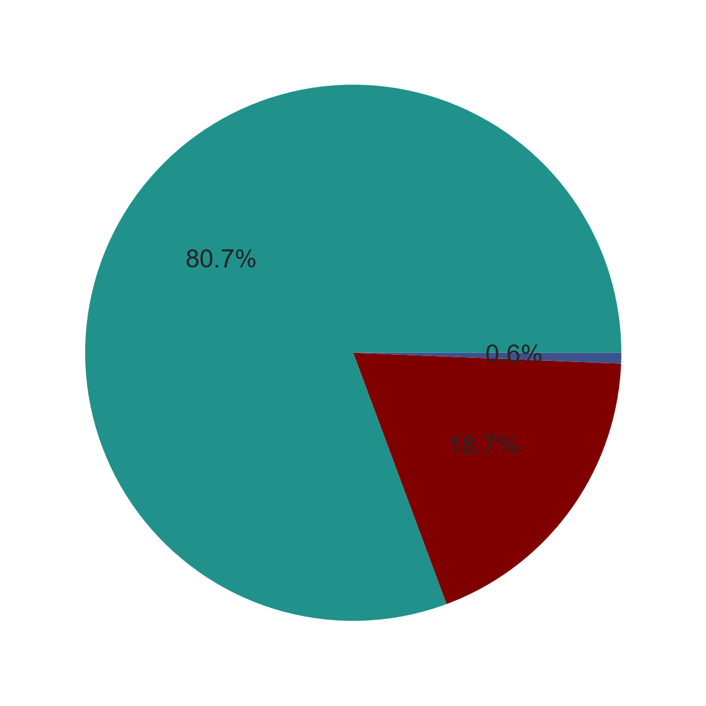
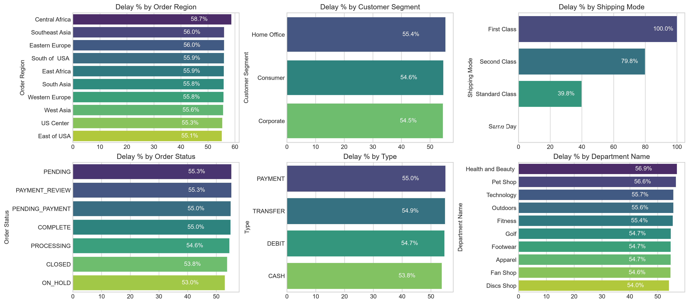
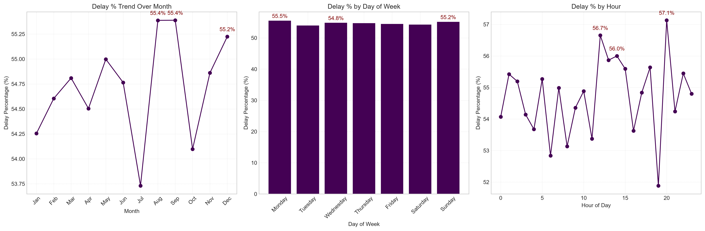

# Supply Chain Delivery Performance Analysis


An end-to-end analysis of order fulfillment for a global e-commerce company. The project finds out **how often orders arrive late, what that costs, and where the delivery process breaks down**, and ends with a ranked list of actions to fix it.

---

## Table of Contents

- [Business Problem](#business-problem)
- [Key Findings](#key-findings)
- [Dataset](#dataset)
- [Approach](#approach)
- [Visual Results](#visual-results)
- [Recommendations](#recommendations)
- [Repository Structure](#repository-structure)
- [How to Run](#how-to-run)
- [Limitations and Next Steps](#limitations-and-next-steps)
- [Author](#author)
- [License](#license)

---

## Business Problem

The company sells sporting goods, fitness equipment, outdoor gear, footwear and apparel in many regions. Actual shipping times often differ from the scheduled delivery window. This causes:

- Late deliveries and lower customer trust
- Less predictable profit per order
- No reliable delivery promise at the time of purchase

**Goal:** understand delivery performance, measure its financial impact, find the main bottlenecks, and recommend practical improvements.

---

## Key Findings

| Metric | Value |
|---|---|
| Orders analyzed (after cleaning) | **172,765** |
| Late deliveries | **94,523** |
| Late delivery rate | **54.71%** |
| On-time delivery rate | **45.29%** |
| 90th percentile delay (late orders only) | **3 days** |
| Profit earned on delayed orders | **$2.1M** |
| Share of orders that are profitable / loss-making / break-even | **80.7% / 18.7% / 0.6%** |

**What the data shows**

- **The problem is company-wide.** Late rates sit between 55% and 59% in every region and between 54.5% and 55.4% in every customer segment. This is not a local failure.
- **Shipping mode is the strongest factor.** Late rate by mode: First Class 100%, Second Class 79.8%, Standard Class 39.8%, Same Day 0%.
- **Most delays are short.** 31.0% of all orders arrive exactly 1 day late. Delays of 1 to 4 days make up the full 54.7% late share.
- **Profit per order barely changes with delay** (about $20 to $23). The money impact comes from the number of late orders, not from each late order being worse.
- **Time patterns are weak.** Delay stays within 53% to 57% across months, weekdays and hours. Small peaks appear in August, September and December, and late in the day.
- **Central Africa has the highest late rate (58.7%).** Shipping mode and payment-related order status are the top drivers there.

> **Note on money figures:** `$2.1M` is the total order profit on delayed orders. The "total profit" of `$7.5M` in the notebook adds up only orders with positive profit, before loss-making orders are subtracted.

---

## Dataset

- **Source:** DataCo Global supply chain dataset (public dataset, file `DataCoSupplyChainDataset.csv`)
- **Raw size:** 180,519 rows × 53 columns
- **After cleaning:** 172,765 rows × 20 columns
- **Period covered:** January 2015 to January 2018
- **Main fields used:** order date, shipping date, scheduled shipping days, shipping mode, order region, customer segment, department, payment type, order status, order profit

---

## Approach

1. **Data cleaning**
   - Removed 33 columns that were personal data, IDs, duplicates of other columns, or had a single value
   - Removed 7,754 canceled orders (not relevant to delivery time)
   - Converted order and shipping dates to proper date format
2. **Feature creation**
   - `Order Processing Time` = shipping date − order date (in days)
   - `Delay` = processing time − scheduled shipping days
   - `Is_Delayed` = `Delay > 0`
   - Month, weekday and hour of each order
   - Profitability flag: Profit, Loss or Break Even
3. **KPI baseline:** late rate, on-time rate, 90th percentile delay and profit figures
4. **Profitability vs delay:** delay distribution, and total and average profit for each delay day
5. **Bottleneck detection:** late rate across region, segment, shipping mode, order status, payment type and department
6. **Root cause analysis:** the top 10 drivers of lateness inside the worst region (Central Africa)
7. **Time analysis:** late rate by month, day of week and hour of day

---

## Visual Results

**Profitability split**

<p align="center"></p>

**Delay distribution and profit by delay days**


**Late rate across six operational categories**



**Top drivers of late delivery in Central Africa**

<p align="center"></p>

**Late rate by month, day of week and hour**



---

## Recommendations

| Priority | Action |
|---|---|
| **Critical** | Audit First Class and Second Class shipping. Review carrier agreements. Until fixed, consider suspending First Class or repricing it. |
| **High** | Fix payment processing delays. Add automatic escalation for payment reviews stuck for more than 2 hours. |
| **Medium** | Plan extra capacity for peak months (August, September, December). |
| **Medium** | Default eligible orders to Standard Class, which has a much lower late rate (39.8%) than First and Second Class. |
| **Medium** | Audit stock, packing time and carrier assignment for Outdoors and Golf in Central Africa. |
| **Low** | Review pricing and discounts behind the 18.7% of loss-making orders. |

---

## Repository Structure

```
.
├── Dataset/                                      # Raw dataset
├── Python/
│   └── Supply_Chain_Analysis.ipynb               # Full analysis notebook
├── Image/                                        # Charts used in this README
├── Supply_Chain_Delivery_Performance_Report.docx # Full written report
├── LICENSE
└── README.md
```

---

## How to Run

**1. Clone the repository**

```bash
git clone https://github.com/riteshastekar/<repository-name>.git
cd <repository-name>
```

**2. Install the requirements**

```bash
pip install pandas numpy matplotlib seaborn jupyter
```

**3. Check the dataset path**

The notebook reads the CSV file with this line:

```python
df = pd.read_csv("../Dataset/DataCoSupplyChainDataset.csv", encoding="latin-1")
```

Make sure the path and file name match the file inside the `Dataset/` folder. The `latin-1` encoding is required for this file.

**4. Open and run the notebook**

```bash
jupyter notebook Python/Supply_Chain_Analysis.ipynb
```

Then run all cells from top to bottom.

---

## Limitations and Next Steps

- **Definition of "late".** Late means the gap between order date and shipping date is greater than the scheduled shipping days. The dataset also has its own delivery status field, which gives a slightly different late count. Results depend on which definition is used.
- **Shipping mode results need a data check.** First Class at exactly 100% late and Same Day at 0% suggest the scheduled days may be tied to the shipping mode. Verify how that field is built before acting on these numbers.
- **Small groups.** Some Central Africa results (for example, payment review at 80%) may come from few orders. Check order counts before acting.
- **Descriptive only.** The analysis explains what happened and where. It does not prove cause and effect.
- **Next steps:**
  - Build a model that predicts which orders are likely to be late before they ship
  - Add carrier, warehouse and weather data
  - Run a pricing and discount analysis on loss-making orders

---

## Author

**Ritesh Astekar**
GitHub: [@riteshastekar](https://github.com/riteshastekar)

---

## License

This project is licensed under the terms in the [LICENSE](LICENSE) file.
